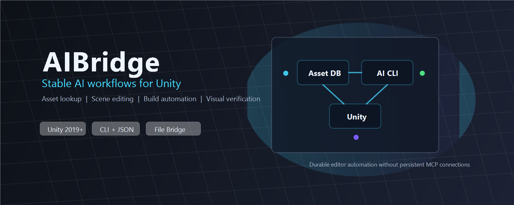

<p align="center">
  
</p>

# AIBridge

English | [中文](./README_CN.md)


**Let your AI assistant work directly in Unity to develop, test, and debug your project.**

AIBridge connects Codex, Claude Code, Cursor, and other AI tools to Unity. Describe a task in natural language and let your assistant inspect scenes, edit Prefabs, compile code, run tests, and check the results using logs, screenshots, and runtime data.

[What You Can Do](#features) · [Benefits](#benefits) · [Quick Start](#quick-start) · [Common APIs](#usage) · [Practical Examples](#examples) · [Optional Tools](#unity-cli)

<a id="features"></a>
## What You Can Do

| Scenario | Supported tasks |
|---|---|
| Everyday coding | Compile in Unity after edits, inspect errors, and run tests |
| Scene and asset editing | Find assets, inspect hierarchies and components, adjust properties, and check or edit Prefabs in batches |
| UI interaction testing | Click, drag, and long-press in Play Mode; capture screenshots or GIFs to inspect behavior |
| Mobile and Player debugging | Connect to a running game to read logs, inspect state, capture screenshots, and sample performance |
| Repetitive task automation | Process objects and assets in batches and combine manual operations |
| Custom development tools | Execute temporary C# for project-specific editing and diagnostics |

<a id="benefits"></a>
## Why Use AIBridge

- **Less manual back-and-forth**: let AI query and operate Unity directly, reducing log copying, object searches, and window switching.
- **Check changes against actual results**: compilation, tests, logs, and images help you assess whether a task is complete.
- **Keep your preferred AI tools**: supports Codex, Claude Code, Cursor, DeepSeek Harness, ZCode, WorkBuddy, and Cline.
- **Work beyond the Editor**: develop scenes and assets, then investigate issues on mobile devices or in built games.
- **Add tools when you need them**: base features work independently; the official Unity CLI, Pipeline, and HybridCLR are optional.

<a id="quick-start"></a>
## Quick Start

### 1. Prepare your environment

- **Unity 2019.4+**, including Unity 6000.x.
- **.NET 8.0 Runtime** for the bundled command-line tool.
- An AI tool that can execute local commands.

### 2. Install

In Unity Package Manager, choose **Add package from git URL** and enter:

```text
https://github.com/liyingsong99/AIBridge.git
```

<details>
<summary>Mirror and development branch</summary>

Mirror: `https://gitee.com/lijoujou99_admin/AIBridge.git`.

Development branch: `https://github.com/liyingsong99/AIBridge.git#dev`.

You can also clone the repository into your Unity project's `Packages` directory.

</details>

### 3. Connect your AI assistant

Open **AIBridge > Setup**, choose your language and AI tools, and finish setup. Keep the Unity project open, open the same project directory in your AI tool, and try:

> Check the current scene for Missing Scripts and list their object paths. Compile in Unity and summarize any errors.

Use **AIBridge > Settings** to configure features and **AIBridge > Workflows** to manage AI-tool integrations. See the [setup guide](./Doc~/SetupWizard.md) for details.

<a id="usage"></a>
## Common APIs

You can also call commands directly. These examples use Windows PowerShell from the project root:

```powershell
$CLI = "./.aibridge/cli/AIBridgeCLI.exe"
& $CLI editor get_state
```

This is the bundled **AIBridgeCLI**; on macOS/Linux, use the corresponding platform executable or CLI DLL. It is separate from the optional official `unity` CLI.

### Query scenes and assets

```powershell
& $CLI scene get_hierarchy --depth 3 --includeInactive false
& $CLI asset find --filter "t:Prefab" --format paths
& $CLI inspector get_components --path "Player"
& $CLI prefab get_hierarchy --prefabPath "Assets/Prefabs/Player.prefab" --includeComponents true
```

Replace the example object and asset paths with those in your project. Preview complex Prefab changes using `prefab patch` with `--dryRun true`.

### Compile, inspect logs, and test

```powershell
& $CLI compile unity
& $CLI get_logs --logType Error --count 50
& $CLI test run --mode EditMode
& $CLI test status
```

Start tests from Edit Mode; use `compile unity` for Unity compilation.

### Interact with UI and capture screenshots

```powershell
& $CLI editor play
& $CLI input click --path "Canvas/StartButton"
& $CLI screenshot game
& $CLI editor stop
```

Clicks require Play Mode and a working UGUI/EventSystem setup. You can also press **F12** for a screenshot or **F11** to record a GIF.

### Capture Editor memory in Edit or Play Mode

```powershell
& $CLI memory capture_snapshot --confirm true --timeout 30000
& $CLI memory snapshot_status --requestId '<original-requestId>'
```

Play Mode is supported by default. Stop Profiler recording and select the local Editor (guid=-1); Player/device capture is unsupported. Capture may pause the Editor and include sensitive runtime heap data. Keep the mode/connection stable: domain reload can leave `unknown/busy`, and exact-request `release_snapshot` only frees local state, without stopping native capture. See [capture conditions and risks](./Doc~/NativeProfiling.en.md).

### Inspect a running Player

```powershell
& $CLI runtime list_targets
& $CLI runtime status --target latest
& $CLI runtime logs --target latest --logType Error --count 50
```

The target must include and enable `AIBridgeRuntime`; it is disabled in Release Builds by default. Specify a target id when multiple devices are connected, or use **AIBridge > Players** to find targets.

Inspect parameters with `& $CLI <command> <action> --help`. See [command examples](./Doc~/CommandExamples.en.md) for more editing, batch processing, capture, and debugging operations.

<a id="examples"></a>
## Practical Examples

Give these tasks to your AI assistant, adding the relevant object paths and expected results for your project:

| Task | Example prompt |
|---|---|
| Resolve compilation errors | “Compile in Unity, locate the errors, fix them, then compile again and check Error logs.” |
| Check Prefabs in batches | “Check button Prefabs for missing click audio. List affected objects and preview changes before applying them after confirmation.” |
| Verify a UI feature | “Enter Play Mode, click the inventory button, confirm the panel opens using a screenshot and logs, then exit Play Mode.” |
| Investigate a device issue | “The Android build's login button does nothing. Connect to the specified device, collect state, logs, and a screenshot, and investigate the cause.” |

Review previews before bulk edits. For interaction tests, describe the expected image or state so the result can be assessed.

<a id="unity-cli"></a>
## Optional Tools: Unity CLI

**AIBridge's base features work without the official Unity CLI.** Install it when you need official Editor / module management or environment diagnostics. On Unity 6.0 LTS+, Pipeline also provides access to official live Editor commands.

- Standalone Unity CLI: install using the [official guide](https://docs.unity.com/en-us/unity-cli/use-unity-cli).
- Pipeline project dependency: click **AIBridge > Install Unity CLI Dependencies** to install a compatible package for the current Editor; an existing version is preserved. This menu does not install the standalone CLI.

AIBridge provides official CLI diagnostics and controlled `code execute --backend pipeline` / `code run --file --entry --args` on verified Pipeline versions. They default to compile-only; execution requires per-request `--dry-run false --confirm true`, and unknown outcomes must not be replayed. Explicit `code run --job true --confirm true` submits background jobs tracked by the original request; upstream execution has no timeout, and cancellation is cooperative rather than rollback. Use other official live commands through `unity command`. Available capabilities depend on versions and project state. See [Unity CLI setup and usage](./Doc~/UnityCliIntegration.en.md).

<a id="documentation"></a>
## More Documentation

- [Pipeline diagnostics and tests](./Doc~/PipelineDiagnostics.md): explicit compilation observation and trigger acknowledgement, EditMode listing and bounded synchronous runs with local request journals
- [Native Player builds](./Doc~/NativeBuild.md): confirmed build runs, persisted reports and CLI status while the Editor is busy
- [Native Profiler files and memory snapshots](./Doc~/NativeProfiling.md): confirmed `.data` save/load and local Editor `.snap` capture, with explicit timeout and recovery limits
- [Command examples and advanced usage](./Doc~/CommandExamples.en.md)
- [Setup guide](./Doc~/SetupWizard.md) and [AI-tool integration management](./Doc~/WorkflowsPanel.md)
- [Editor window capture](./Doc~/EditorWindowScreenshot.md)
- [Unity CLI setup and usage](./Doc~/UnityCliIntegration.en.md)
- [Full documentation index](./Doc~/README.md)

## Contributing and License

Issues and pull requests are welcome. See [CONTRIBUTING.md](./CONTRIBUTING.md) for development instructions. Licensed under the [MIT License](./LICENSE).
