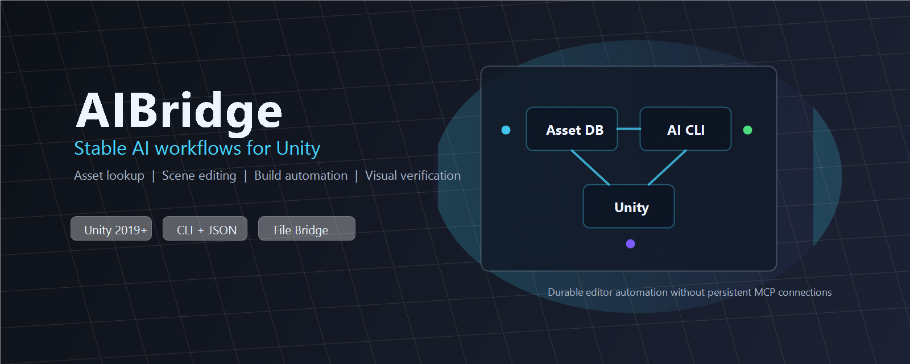

<p align="center">
  
</p>

# AIBridge

[English](./README.md) | 中文


**让你的 AI 助手直接操作 Unity，完成开发、测试和调试。**

AIBridge 将 Codex、Claude Code、Cursor 等 AI 工具接入 Unity。你可以用自然语言提出任务，让 AI 检查场景、修改 Prefab、执行编译与测试，并读取日志、截图和运行数据来确认结果。

[能做什么](#features) · [使用优势](#benefits) · [快速开始](#quick-start) · [常用 API](#usage) · [实践示例](#examples) · [可选增强](#unity-cli)

<a id="features"></a>
## 能做什么

| 使用场景 | 可以完成的工作 |
|---|---|
| 日常代码开发 | 修改代码后执行 Unity 编译、查看错误、运行测试 |
| 场景与资源编辑 | 查找资源、查看层级与组件、调整属性、批量检查和修改 Prefab |
| UI 交互测试 | 在 Play Mode 中点击、拖拽、长按，截图或录制 GIF 检查表现 |
| 手机与 Player 调试 | 连接运行中的游戏，读取日志、查看状态、截图和采集性能数据 |
| 重复任务自动化 | 批量处理对象和资源，把多次手工操作组合执行 |
| 定制开发工具 | 执行临时 C#，处理项目特有的编辑与诊断任务 |

<a id="benefits"></a>
## 为什么使用 AIBridge

- **减少手工往返**：让 AI 直接查询和操作 Unity，减少复制日志、查找对象、切换窗口的步骤。
- **用实际结果验证改动**：编译结果、测试、日志和画面帮助你判断任务是否完成。
- **继续使用熟悉的 AI 工具**：支持 Codex、Claude Code、Cursor、DeepSeek Harness、ZCode、WorkBuddy 和 Cline。
- **从编辑器延伸到运行设备**：既能开发场景与资源，也能排查手机或已编译游戏中的问题。
- **按需启用增强**：基础功能可独立使用，官方 Unity CLI、Pipeline 和 HybridCLR 均非必装。

<a id="quick-start"></a>
## 快速开始

### 1. 准备环境

- **Unity 2019.4+**，包括 Unity 6000.x。
- **.NET 8.0 Runtime**，用于运行随包命令行工具。
- 一个能执行本地命令的 AI 工具。

### 2. 安装

在 Unity Package Manager 中选择 **Add package from git URL**，输入：

```text
https://github.com/liyingsong99/AIBridge.git
```

<details>
<summary>备用地址与开发分支</summary>

备用地址：`https://gitee.com/lijoujou99_admin/AIBridge.git`。

开发分支：`https://github.com/liyingsong99/AIBridge.git#dev`。

也可克隆仓库到 Unity 项目的 `Packages` 目录。

</details>

### 3. 连接 AI 助手

打开 **AIBridge > Setup**，选择语言和 AI 工具，完成设置。保持 Unity 工程打开，在 AI 工具中打开同一项目目录，然后试试：

> 检查当前场景中的 Missing Script，列出对象路径；执行 Unity 编译并总结错误。

后续可在 **AIBridge > Settings** 调整功能，在 **AIBridge > Workflows** 管理 AI 工具集成。更多设置见[设置向导](./Doc~/SetupWizard.md)。

<a id="usage"></a>
## 常用 API

除了让 AI 操作，你也可以通过命令行直接调用。以下示例使用 Windows PowerShell，在项目根目录执行：

```powershell
$CLI = "./.aibridge/cli/AIBridgeCLI.exe"
& $CLI editor get_state
```

这是随包提供的 **AIBridgeCLI**；macOS/Linux 使用对应平台可执行文件或 CLI DLL。它与可选的官方 `unity` CLI 不同。

### 场景与资源查询

```powershell
& $CLI scene get_hierarchy --depth 3 --includeInactive false
& $CLI asset find --filter "t:Prefab" --format paths
& $CLI inspector get_components --path "Player"
& $CLI prefab get_hierarchy --prefabPath "Assets/Prefabs/Player.prefab" --includeComponents true
```

将示例对象和资源路径换成你的项目路径。复杂 Prefab 修改可先通过 `prefab patch` 的 `--dryRun true` 预览。

### 编译、日志和测试

```powershell
& $CLI compile unity
& $CLI get_logs --logType Error --count 50
& $CLI test run --mode EditMode
& $CLI test status
```

测试从 Edit Mode 启动；Unity 编译使用 `compile unity`。

### UI 操作与截图

```powershell
& $CLI editor play
& $CLI input click --path "Canvas/StartButton"
& $CLI screenshot game
& $CLI editor stop
```

点击需要 Play Mode 和可用的 UGUI/EventSystem。也可用 **F12** 截图、**F11** 录制 GIF。

### 运行中的 Player

```powershell
& $CLI runtime list_targets
& $CLI runtime status --target latest
& $CLI runtime logs --target latest --logType Error --count 50
```

目标需包含并启用 `AIBridgeRuntime`，Release Build 默认关闭。多设备时指定 target id；也可通过 **AIBridge > Players** 查找目标。

查看参数：`& $CLI <command> <action> --help`。更多编辑、批处理、截图和调试用法见[命令示例](./Doc~/CommandExamples.md)。

<a id="examples"></a>
## 实践示例

下面这些任务可以直接交给 AI，再根据项目情况补充对象路径和预期结果：

| 任务 | 可以这样描述 |
|---|---|
| 排查编译错误 | “执行 Unity 编译，定位报错原因，修复后重新编译并检查 Error 日志。” |
| 批量检查 Prefab | “检查按钮 Prefab 是否缺少点击音效，先列出待修改对象并预演，确认后应用。” |
| 验证 UI 功能 | “进入 Play Mode，点击背包按钮，用截图和日志确认面板打开，完成后退出。” |
| 排查真机问题 | “Android 包里登录按钮没有反应，连接指定设备，收集状态、日志和截图，分析原因。” |

涉及批量修改时先检查预览；验证交互时明确预期画面或状态，便于判断结果。

<a id="unity-cli"></a>
## 可选增强：Unity CLI

**无需安装官方 Unity CLI 即可使用 AIBridge 的基础功能。** 按需安装后，可以补充官方 Editor / 模块管理、环境诊断等工具；Unity 6.0 LTS+ 配合 Pipeline 还可使用官方实时 Editor 命令。

- 独立 Unity CLI：按[官方指南](https://docs.unity.com/en-us/unity-cli/use-unity-cli)安装。
- 项目依赖 Pipeline：点击 **AIBridge > Install Unity CLI Dependencies**，安装当前 Editor 兼容的包，已有版本会保留。此菜单不安装独立 CLI。

AIBridge 提供官方 CLI 诊断，并在已核实的 Pipeline 版本上支持受控 `code execute --backend pipeline` 与 `code run --file --entry --args`：默认仅编译，实际执行需逐次 `--dry-run false --confirm true`，未知结果禁止重放。`code run --job true --confirm true` 可显式提交后台作业并按原请求查询；此模式执行无上游超时，取消是合作请求而非回滚。其它官方实时命令通过 `unity command` 使用。安装后可用能力取决于版本和项目状态，详见 [Unity CLI 配置与使用](./Doc~/UnityCliIntegration.md)。

<a id="documentation"></a>
## 更多文档

- [Pipeline 编译观察与受限测试](./Doc~/PipelineDiagnostics.md)：显式全局编译观察及触发应答、EditMode目录与单次同步测试、本地请求日志
- [原生 Player 构建](./Doc~/NativeBuild.md)：显式确认、纯 DTO 报告及 Editor 忙碌时的 CLI 状态查询
- [原生 Profiler 文件与内存快照](./Doc~/NativeProfiling.md)：显式确认保存/加载 `.data`、捕获本地 Editor `.snap`，以及超时与恢复边界
- [命令示例与进阶用法](./Doc~/CommandExamples.md)
- [设置向导](./Doc~/SetupWizard.md)与[AI 工具集成管理](./Doc~/WorkflowsPanel.md)
- [Editor 窗口截图](./Doc~/EditorWindowScreenshot.md)
- [Unity CLI 配置与使用](./Doc~/UnityCliIntegration.md)
- [完整文档目录](./Doc~/README.md)

## 贡献与许可证

欢迎提交 issue 和 pull request。开发说明见 [CONTRIBUTING.md](./CONTRIBUTING.md)。项目采用 [MIT License](./LICENSE)。
